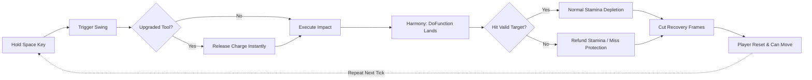

<div align="center">

# Animation Canceler

**Effortless, rapid tool animation canceling for Stardew Valley 1.6+**

[](https://www.stardewvalley.net/)
[](https://smapi.io/)
[](https://dotnet.microsoft.com/)
[](https://opensource.org/licenses/MIT)
[](https://www.nexusmods.com/stardewvalley/mods/5098)

<p align="center">
  <b>Hold a single key to chop trees, break rocks, till soil, and water crops at maximum speed with automatic post-swing recovery cancellation and smart energy protection.</b>
</p>

---

</div>

## Overview

In vanilla *Stardew Valley*, swinging a tool incurs a lengthy post-impact recovery animation before your character can move or swing again.

**Animation Canceler** hooks directly into SMAPI and Harmony to detect the exact frame your tool impacts the world. By holding your configured activation key (default: `Space`), the mod instantly cancels the recovery frames and begins the next swing, providing continuous gathering efficiency without finger fatigue or multi-key macros.



---

## Key Features

### Rapid Gathering
- **Single-Key Activation:** Hold `Space` while holding any gathering tool.
- **Precision Timing:** Cancels the animation the exact instant `Tool.DoFunction` registers on the map.

### Smart Stamina Miss Protection
- **No Wasted Energy:** In vanilla Stardew, swinging a tool at empty air consumes stamina. With **Animation Canceler**, swinging at air, missing, or watering already-watered tiles refunds your stamina immediately.
- **Exhaustion Guard:** Automatically halts auto-swinging when your energy drops to or below your configured safety threshold (default: `10`), preventing collapse.

### Upgraded Tool Support
- Upgraded tools (Copper, Steel, Gold, Iridium) normally lock into a charging state when tool buttons are held. **Animation Canceler** releases the tool on frame one, allowing continuous single-tile rapid swings without getting stuck.

---

## Supported Tools

| Tool | Action | Hit Detection (Miss Protection) |
|:---:|:---|:---|
| **Axe** | Woodcutting & Clearing | Trees, Fruit Trees, Bushes, Giant Crops, Stumps, Hollow Logs, Twigs, Weeds |
| **Pickaxe** | Mining & Quarrying | Stones, Ore Nodes, Resource Clumps (Boulders, Meteors), Flooring, Tilled Soil (un-till) |
| **Hoe** | Tilling & Harvesting | Diggable Ground, Artifact Spots, Forage, Harvestable Crops |
| **Watering Can** | Watering & Refilling | Un-watered Tilled Soil, Water Tiles (refill), Pet Bowls, Water Troughs |

> [!NOTE]
> **Weapons & Scythes:** This mod is purposefully dedicated to **gathering tools**. Melee weapons and scythes are excluded to preserve vanilla combat balance and avoid conflicting swipe mechanics.

---

## Requirements

- **[Stardew Valley](https://www.stardewvalley.net/)** (v1.6.0 or newer)
- **[SMAPI](https://smapi.io/)** (v4.0.0 or newer)
- *(Optional)* **[Generic Mod Config Menu (GMCM)](https://www.nexusmods.com/stardewvalley/mods/5098)** for in-game configuration UI.

---

## Installation

1. Download the latest release from the [GitHub Releases](https://github.com/acipuns-dot/AnimationCanceler/releases) tab.
2. Extract the downloaded `.zip` file.
3. Move the `AnimationCanceler` folder into your game's `Mods` directory:
   - **Windows:** `C:\Program Files (x86)\Steam\steamapps\common\Stardew Valley\Mods`
   - **GOG:** `C:\GOG Games\Stardew Valley\Mods`
   - **macOS:** `~/Library/Application Support/Steam/steamapps/common/Stardew Valley/Contents/MacOS/Mods`
   - **Linux:** `~/.local/share/Steam/steamapps/common/Stardew Valley/Mods`
4. Launch the game through **SMAPI**.

---

## Configuration

Configure the mod in-game using **Generic Mod Config Menu**, or edit `config.json` generated in the mod folder after first launch:

```json
{
  "HoldKey": "Space",
  "PreventExhaustion": true,
  "MinimumStamina": 10.0,
  "OnlyDrainStaminaOnHit": true,
  "Enabled": true
}
```

### Options Breakdown

| Setting | Type | Default | Description |
|:---|:---:|:---:|:---|
| `HoldKey` | `SButton` | `"Space"` | Key held to trigger auto-swing and animation canceling. |
| `PreventExhaustion` | `bool` | `true` | Stops swinging when stamina reaches the minimum threshold. |
| `MinimumStamina` | `float` | `10.0` | Minimum stamina limit before the safety guard halts swinging. |
| `OnlyDrainStaminaOnHit` | `bool` | `true` | Refunds stamina when tool swings miss or hit empty air. |
| `Enabled` | `bool` | `true` | Master toggle to enable or disable the mod. |

---

## Building from Source

This project targets **.NET 6.0** and uses [Pathoschild.Stardew.ModBuildConfig](https://github.com/Pathoschild/SMAPI#readme).

1. Clone the repository:
   ```bash
   git clone https://github.com/acipuns-dot/AnimationCanceler.git
   ```
2. Build with the .NET CLI:
   ```bash
   dotnet build -c Release
   ```
   *The build script will automatically detect your local Stardew Valley directory and deploy the mod.*

---

## License

Distributed under the **MIT License**. See `LICENSE` for details.
